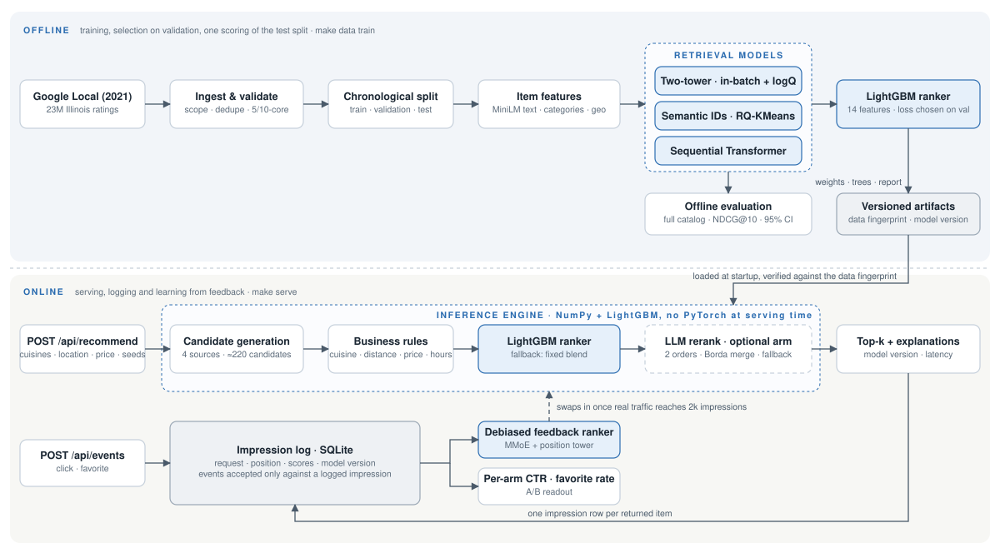
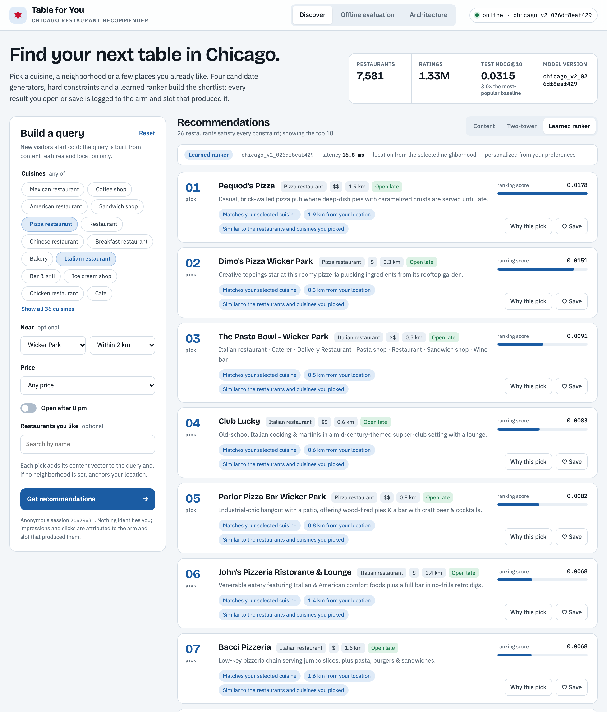
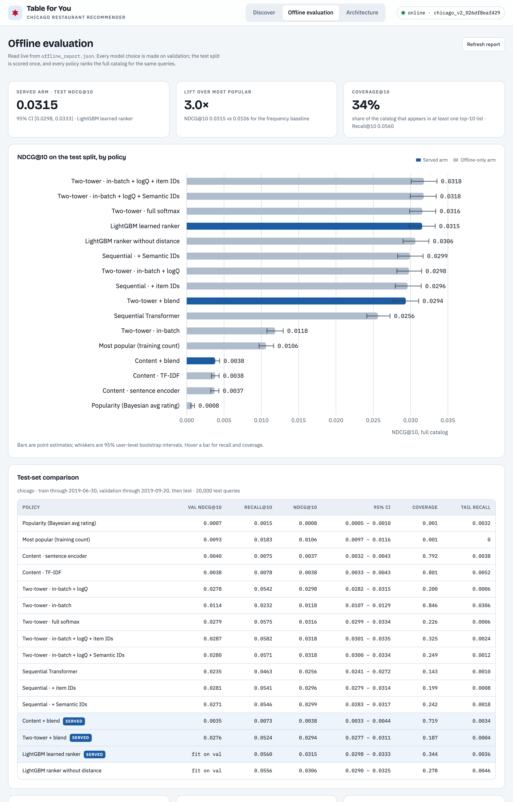
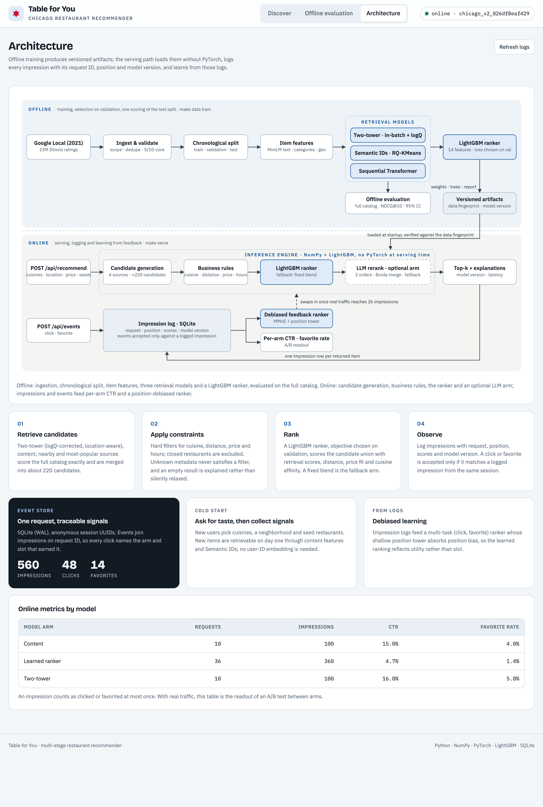

# Chicago Restaurant Recommender System

An end-to-end, multi-stage recommender system for restaurants in Chicago, trained on 1.33 million Google Maps ratings from 106,000 users across 7,581 restaurants. The system implements the complete industrial recommendation pipeline: data ingestion with leakage-safe chronological splitting, candidate generation (two-tower retrieval with sampling-bias correction, content-based and geographic retrieval, an approximate nearest neighbor index), item tokenization with Semantic IDs, sequential modeling with a Transformer, learning-to-rank with gradient-boosted trees, business-rule filtering, a low-latency serving API over versioned model artifacts, impression-level logging for online A/B measurement, and a position-debiased model trained from feedback logs. Every component is evaluated under a single full-catalog protocol with bootstrap confidence intervals and baselines in every table.


> A plain-language introduction to the system, in English and Chinese, is available at **[Inside Table for You](https://hanshuo-shuo.github.io/chicago-restaurant-recommender/)**. It covers the data and its attribution, the baselines, each model, the evaluation methodology and the deployed components. Source: [docs/index.html](docs/index.html).



## Technical Highlights

| Area | Implementation | Modules |
|---|---|---|
| **Candidate generation** | Two-tower retrieval model (MLP towers, temperature-scaled cosine similarity, item bias) trained with in-batch negatives and logQ sampling-bias correction [16]; content-based retrieval over sentence-encoder embeddings; popularity and geographic candidate sources; inverted-file (IVF) approximate nearest neighbor index [24] | `two_tower.py`, `retrieval.py`, `ann.py` |
| **Item representation** | Semantic IDs produced by residual-quantized k-means (RQ-KMeans) [6] and used as prefix embeddings [2]; compared against per-item ID embeddings and pure content features under identical training budgets | `semantic_ids.py`, `features.py` |
| **Sequential recommendation** | SASRec-style causal Transformer [18, 29] trained with an autoregressive next-item objective [4] over length-bucketed interaction histories | `sequential.py` |
| **Learning to rank** | LightGBM [19] ranker over 14 engineered features drawn from four candidate sources; LambdaRank [20], pointwise logistic and XE-NDCG [28] objectives compared on held-out validation users | `ranker.py` |
| **Geo-aware recommendation** | Gaussian RBF geographic features in both towers, a nearest-restaurants candidate source, a distance ranking feature and a distance business rule | `geo.py`, `ranker.py`, `ranking.py` |
| **Cold-start handling** | Inductive two-tower model with no user-ID embedding; item features built from metadata only, so new items are retrievable immediately; explicit preference elicitation; a separate cold-start dataset in which 92% of users have a single rating | `features.py`, `engine.py` |
| **Offline evaluation** | Global chronological split [14]; full-catalog Recall@K and NDCG@K [27] without sampled negatives [15]; user-level bootstrap confidence intervals [31]; catalog coverage and tail- and new-item recall; model selection on validation and a single scoring of the test split | `evaluation.py`, `training.py` |
| **Serving** | Versioned artifacts bound to a data fingerprint; NumPy and LightGBM inference with no PyTorch dependency; schema-validated HTTP API; end-to-end p50 latency of 12.9 ms for the learned-ranker arm | `engine.py`, `server.py` |
| **Online experimentation** | Impression-level logging with position, scores and model version; click and favorite events attributed to the exact impression that produced them; per-arm CTR and favorite rate as the A/B readout | `server.py` |
| **Learning from feedback** | Multi-gate Mixture-of-Experts (MMoE) [23] click and favorite model with a shallow position-bias tower [17], validated on simulated logs with a known position-bias curve | `feedback.py` |
| **LLM reranking** | Optional Claude reranking arm with order-sensitivity mitigation (two candidate orders merged by Borda count) [11], structured output and server-side fallback to the base ranking | `llm_rerank.py` |
| **Engineering** | 64 automated tests (unit, HTTP contract, synthetic end-to-end, real-artifact end-to-end); continuous integration on Python 3.9 and 3.12; serving Dockerfile; Makefile-driven pipeline | `tests/`, `.github/workflows/ci.yml`, `Dockerfile` |

## Experimental Results

**Chicago test split.** 20,000 user-day queries from 10,016 users (September–December 2019). Every policy ranks the **full catalog** of 7,581 restaurants. A positive is a rating of 4 or higher. Models are trained on data through 2019-06-30 and selected on validation (July–September 2019). Intervals are 95% user-level bootstrap intervals [31].

| Policy | Recall@10 | NDCG@10 [95% CI] | Coverage@10 |
|---|---:|---:|---:|
| Popularity (Bayesian average rating) | 0.0015 | 0.0008 [0.0005, 0.0010] | 0.001 |
| Most popular (training count) | 0.0183 | 0.0106 [0.0097, 0.0116] | 0.001 |
| Content (sentence encoder) | 0.0075 | 0.0037 [0.0032, 0.0043] | 0.79 |
| Sequential Transformer + Semantic IDs | 0.0546 | 0.0299 [0.0283, 0.0317] | 0.24 |
| Two-tower (in-batch + logQ) + blend · served as `two_tower` | 0.0524 | 0.0294 [0.0277, 0.0311] | 0.19 |
| **LightGBM ranker · served default `learned`** | **0.0560** | **0.0315 [0.0298, 0.0333]** | **0.34** |

The served ranker achieves **3.0× the NDCG@10 of the strongest non-personalized baseline** and **1.8× the catalog coverage** of the two-tower blend it replaces, with confidence intervals that do not overlap those of any baseline.

### Ablation Findings

1. **Sampling-bias correction is required for in-batch negatives.** The logQ correction raises the two-tower model from 0.0118 to 0.0298 NDCG@10 (2.5×) and matches an exact full softmax (0.0316, overlapping intervals) at a fraction of the per-step cost. Without the correction, the model exhibits the bias described by Yi et al. [16]: popular restaurants are over-penalized (coverage 0.85, tail-item recall 0.031).
2. **Semantic IDs match per-item ID embeddings with 47% fewer embedding rows.** Adding ID or Semantic-ID embeddings improves the two-tower model by approximately 7% (0.0298 → 0.0318) and the sequential model by approximately 16% (0.0256 → 0.0299). Semantic IDs reach the same accuracy with 4,039 embedding rows instead of 7,581.
3. **The ranking objective must be selected empirically.** LambdaRank scored below a ranking by two-tower score alone on held-out validation (0.0286 vs 0.0297): with one or two positives among approximately 220 candidates, pairwise gradients are sparse. A pointwise logistic objective outperformed both and is the served configuration. Every ranker is therefore reported alongside its strongest single input feature.
4. **Geographic signal is substantial and largely captured upstream.** The median positively rated restaurant lies 3.8 km from the user's usual area, and 61% lie within 5 km. Distance is the ranker's second-ranked feature by gain, yet removing it reduces NDCG@10 by only 3%, because location also enters through the two-tower model's geographic features and the nearby candidate source.
5. **The sequential model matches, but does not exceed, the geo-aware two-tower model** (0.0299 vs 0.0298–0.0318). At 1.3M interactions, additional model capacity yields gains that are modest and in some cases within noise, consistent with the finding that well-tuned simple baselines remain competitive [13].
6. **Popularity must be measured as interaction frequency.** Ranking by Bayesian-average rating performs 13× worse than ranking by training interaction count, because it surfaces rarely visited restaurants with few, high ratings.
7. **Approximate nearest neighbor retrieval is benchmarked but not required at this catalog size.** An IVF index recovers 94.7% of the exact top-100 while scanning 20% of the catalog (0.32 vs 0.78 ms per query). Exact scoring of 7.6k items costs approximately 1 ms, so serving remains exact.

<details>
<summary><b>Full ablation tables</b> (two-tower negatives and identity; sequential model; ranker objective)</summary>

**Two-tower: negatives and item identity.** Every variant uses the same towers, data and epoch budget.

| Variant | Val NDCG@10 | Recall@10 | NDCG@10 [95% CI] | Coverage@10 | Tail-item recall |
|---|---:|---:|---:|---:|---:|
| In-batch negatives, no correction | 0.0114 | 0.0232 | 0.0118 [0.0107, 0.0129] | 0.85 | 0.031 |
| **In-batch + logQ correction [16]** (served) | 0.0278 | 0.0542 | 0.0298 [0.0282, 0.0315] | 0.20 | 0.001 |
| Full softmax over 7,581 items | 0.0279 | 0.0575 | 0.0316 [0.0299, 0.0334] | 0.23 | 0.001 |
| In-batch + logQ + per-item ID embeddings | 0.0287 | 0.0582 | 0.0318 [0.0301, 0.0335] | 0.33 | 0.002 |
| In-batch + logQ + Semantic-ID embeddings [2, 6] | 0.0280 | 0.0571 | 0.0318 [0.0300, 0.0334] | 0.25 | 0.001 |

Model selection used a 4,000-query validation subsample, on which the content-only logQ model narrowly won; on the full validation set the ID variant is marginally ahead, within noise.

**Sequential Transformer and learned ranker.**

| Variant | Val NDCG@10 | Recall@10 | NDCG@10 [95% CI] |
|---|---:|---:|---:|
| Sequential, content + geo item inputs | 0.0235 | 0.0463 | 0.0256 [0.0241, 0.0272] |
| Sequential + per-item IDs | 0.0281 | 0.0541 | 0.0296 [0.0279, 0.0314] |
| Sequential + Semantic IDs | 0.0271 | 0.0546 | 0.0299 [0.0283, 0.0317] |
| Ranker objective: LambdaRank [20] | 0.0286 (held-out) | — | — |
| Ranker objective: pointwise logistic (selected) | 0.0303 (held-out) | 0.0560 | 0.0315 [0.0298, 0.0333] |
| Ranker objective: XE-NDCG [28] | 0.0300 (held-out) | — | — |
| Selected ranker without the distance feature | fit on val | 0.0556 | 0.0306 [0.0290, 0.0325] |

</details>

<details>
<summary><b>Evanston cold-start dataset</b> (66 restaurants; 92% of users have one rating)</summary>

Test split: 67 queries from 56 users, NDCG@5.

| Policy | Validation NDCG@5 | Recall@5 | NDCG@5 [95% CI] | Tail-item recall |
|---|---:|---:|---:|---:|
| Popularity (Bayesian average) | 0.026 | 0.031 | 0.035 [0.000, 0.075] | 0.00 |
| Content · TF-IDF [32] | 0.095 | 0.090 | 0.057 [0.019, 0.100] | 0.11 |
| **Content · sentence encoder + blend (served)** | 0.097 | **0.135** | **0.088 [0.043, 0.137]** | **0.17** |
| Two-tower (selected on validation) + blend | 0.127 | 0.062 | 0.040 [0.013, 0.077] | 0.09 |

Replacing TF-IDF with a frozen pretrained sentence encoder (MiniLM [21, 22]) improves content retrieval by 55% in NDCG@5 and 50% in Recall@5 in this cold-start regime. The two-tower model wins on validation and loses on test, which shows that 70–90 queries per split cannot separate models reliably; the simpler content model remains the served default.

</details>

### Serving Latency

`make bench` on an Apple M1 Pro: 500 random preference queries per arm after warm-up, half with a location and a 5 km radius. HTTP time includes request validation and the synchronous SQLite writes (one request row and one impression row per result).

| Arm | Engine p50 / p95 / p99 | HTTP p50 / p95 / p99 |
|---|---:|---:|
| Content + blend | 1.6 / 4.8 / 8.8 ms | 8.4 / 14.6 / 25.6 ms |
| Two-tower + blend | 1.6 / 4.0 / 6.8 ms | 8.8 / 20.9 / 36.6 ms |
| Learned ranker (≈220 candidates, LightGBM) | 7.3 / 12.6 / 27.4 ms | 12.9 / 20.8 / 38.3 ms |

## System Architecture

| Stage | Implementation | Design notes |
|---|---|---|
| **Data** | Google Local (2021) Illinois files → Chicago/Evanston restaurants, 2016–2019; latest rating per (user, item); iterative 5-core users / 10-core items | Raw account IDs are dropped at ingestion. Google's all-time `avg_rating` and `num_of_reviews` are never stored, as they would leak future information. The filtering funnel is written to `data_quality.json`. |
| **Features** | all-MiniLM-L6-v2 [21, 22] over name, categories, description and attributes; category multi-hot; price, cost and hours with "known" indicators; Gaussian RBF over 32 k-means geographic anchors [33, 34] | Built from metadata only, so new items are retrievable on day one. The text backend (sentence encoder vs TF-IDF [32]) is selected on validation. The encoded matrix ships with the artifacts, so serving never loads the encoder. |
| **Two-tower** | MLP towers, cosine/τ + item bias; query = content preference vector ⊕ geo RBF; item = content ⊕ geo (⊕ ID or Semantic-ID embedding) | No user-ID embedding: the model is inductive and serves cold users. Full softmax, in-batch and in-batch + logQ [16] losses are compared under identical budgets. All PyTorch models are trained with Adam [30]. |
| **Semantic IDs** | RQ-KMeans, 3 levels × 64 codes, as in OneRec [6]; prefix embeddings as in Singh et al. [2] | 2,890 distinct IDs for 7,581 items; chain branches share IDs. The deepest embedding table has 2,890 rows rather than 64³. |
| **Sequential** | SASRec-style causal Transformer [18, 29] over the last 50 interactions, autoregressive next-item objective (the generative framing of HSTU [4]) | Length-bucketed batches halve epoch time (median history 8, window 50). Offline research arm. |
| **Candidates** | Union of two-tower top-100, content top-50, most-popular top-50 and nearby top-50 (≈220 after deduplication) | Candidate recall on validation is approximately 30%, which bounds the ranker. Filters are applied before truncation. |
| **Ranker** | LightGBM [19] over 14 features: retrieval scores and ranks, popularity and 90-day trend, Bayesian rating, distance, cuisine affinity, price gap, open-late indicator, history length and mean rating | Fitted on validation queries with retrievers frozen at the training cutoff; early stopping on held-out users. The 2021 "closed" flag is excluded as future leakage and used only as a serving filter. |
| **Business rules** | Cuisine, maximum price level, budget, open after 8 pm, maximum distance, permanently closed | Applied before truncation. Unknown metadata never satisfies a filter. Empty results are explained rather than silently relaxed. |
| **ANN** | IVF index [24] with the item bias folded into the vectors | Returns exact two-tower scores for visited items. Benchmarked against exact search. |
| **Feedback** | MMoE [23] click/favorite ranker with a shallow position tower [17], trained from impression logs | Verified on simulated logs: recovers the planted −1.2·log(position) bias curve with r > 0.9. The CLI refuses to train on fewer than 2,000 impressions and 100 clicks of real traffic. |
| **LLM arm** | Claude reranks the top 20 under two candidate orders, merged by Borda count [11]; structured JSON output; any failure retains the base order | Disabled by default. Logs its own model version, so its effect is measured as an online A/B readout rather than an offline estimate. |

The full design document, including data contracts, train/serve skews and the changes required at 10M users, is in [docs/design.md](docs/design.md).

### Evaluation Protocol

- **Global chronological split**, 80/10/10 by interactions with whole days on one side [14]. Random and leave-one-out splits expose future interactions during training.
- **Models frozen at the cutoff, features fresh.** Each query sees the user's history strictly before the query day, as a deployed system would.
- **Query unit = (user, day)**; every rating of 4 or higher on that day is a target. **Full catalog**, never sampled negatives [15].
- **Uncertainty:** 95% percentile bootstrap [31], resampling users rather than queries.
- **Selection discipline:** the text backend, two-tower loss and identity, sequential variant, early stopping and ranker objective are all chosen on validation. The test split is scored once per policy.

### Serving and Feedback Loop

Every `POST /api/recommend` writes one `requests` row and one `impressions` row per returned item (position, retrieval score, ranking score, distance, model version). A click or favorite is accepted only if `(request_id, session_id, item_id)` matches a logged impression; its position and model version are copied from that impression and are never taken from the client. `GET /api/online-metrics` reports per-arm CTR and favorite rate, which constitute the A/B readout between arms.

| Method | Path | Purpose |
|---|---|---|
| `POST` | `/api/recommend` | Top-k for `{session_id, model, k, preferences}`. `model` ∈ `baseline`, `two_tower`, `learned`, `llm`. Preferences: `cuisines`, `location`, `max_distance_km`, `max_price_level`, `budget`, `open_after_8pm`, `seed_item_ids`, `exclude_seen`. |
| `POST` | `/api/events` | `click` or `favorite` for `{session_id, request_id, item_id}`; rejected unless it matches a logged impression. |
| `GET` | `/api/online-metrics` | Requests, impressions, CTR and favorite rate per model arm. |
| `GET` | `/api/metrics` | The offline evaluation report. |
| `GET` | `/api/info`, `/api/search?q=`, `/api/catalog`, `/api/health` | Served arms and presets; name search for seed restaurants; catalog; status, artifact version and log counts. |

```bash
curl -s localhost:8766/api/recommend -H 'Content-Type: application/json' -d '{
  "session_id": "3f1c2a9e-5b7d-4c1e-9a2f-6d8e0b4c7a15", "model": "learned", "k": 3,
  "preferences": {"cuisines": ["Pizza restaurant", "Italian restaurant"], "max_price_level": 2,
                  "location": {"latitude": 41.9088, "longitude": -87.6796}, "max_distance_km": 2}}'
```

```jsonc
{
  "recommendations": [
    {"item_id": "0x880fd2e43edcab43:0xfa179f0b298abc4d", "name": "Pequod's Pizza", "cuisine": "Pizza restaurant",
     "price_level": 2, "distance_km": 1.93, "ranking_score": 0.017766, "retrieval_score": 6.666064,
     "reasons": ["Matches your selected cuisine.", "Price level fits your limit.", "1.9 km from your location.",
                 "Similar to the restaurants and cuisines you picked."]},
    {"name": "Dimo's Pizza Wicker Park", "distance_km": 0.32, "...": "..."},
    {"name": "The Pasta Bowl - Wicker Park", "distance_km": 0.46, "...": "..."}
  ],
  "model": "learned", "model_version": "chicago_v2_026df8eaf429",
  "candidate_count": 21, "location_source": "request", "impressions_logged": 3
}
```

Request validation and security: strict schemas that reject unknown fields (including any user identifier), range checks on every numeric field, a 16 KiB body limit, a same-origin check on writes, Content Security Policy and `nosniff` headers, and structured JSON access logs that never include request bodies.

## Web Interface

The service includes a single-page demo application, **Table for You**, for composing queries, comparing model arms on the same request and observing impressions and events in the online metrics. Queries can be expressed as URLs, for example:

```
http://127.0.0.1:8766/?cuisines=Pizza%20restaurant,Italian%20restaurant&near=Wicker%20Park&radius=2&model=learned&run=1
```






<sub>Online metrics in the screenshots are produced by scripted demo traffic, not real users. Restaurant names and short descriptions in the screenshots come from Google Maps business metadata distributed in Google Local Data (2021) [25, 26]; they belong to their respective owners and are shown only to illustrate the system's output.</sub>

## Getting Started

```bash
python -m venv .venv && source .venv/bin/activate
pip install -e ".[dev]"     # numpy, openpyxl, torch, sentence-transformers, lightgbm, pytest

make download               # Google Local (2021) Illinois files, about 480 MB -> data/raw/google_local/
make data                   # Chicago + Evanston restaurants -> data/processed/chicago/   (about 35 s)
make train                  # every retriever, ranker and ablation -> artifacts/chicago/   (about 40 min, M1 Pro CPU)
make test
make serve                  # API + UI on http://127.0.0.1:8766
```

- **Smoke run:** `make train ARGS=--quick` trains in minutes; the resulting metrics are not meaningful.
- **Evanston dataset:** place `RestaurantReviews.xlsx` in `data/raw/` and add `DATASET=evanston` to any target.
- **LLM arm:** `pip install -e '.[llm]'`, set Anthropic credentials, then `make serve ARGS=--llm-rerank`.
- **Docker (serving only, no PyTorch in the image):**

```bash
make data train
docker build -t restaurant-recs .
docker run --rm -p 8766:8766 -v "$PWD/data:/app/data" -v "$PWD/artifacts:/app/artifacts" restaurant-recs
```

## Data

| | Chicago (Google Local 2021) [25, 26] | Evanston (workbook) |
|---|---|---|
| Items | 7,581 restaurants (7,374 Chicago, 207 Evanston), 1,149 now permanently closed | 66 (63 catalog + 3 seen only in ratings) |
| Interactions | 1.33M ratings from 106k users, 2016–2019 (from 23M Illinois ratings) | 1,436 ratings from 1,047 users, 2016–2023 |
| Filtering | Chicago/Evanston restaurants; latest rating per user and restaurant; 5-core users, 10-core items | Exact duplicates removed; 15 unparseable dates quarantined |
| Density | 0.17%; median 8 ratings per user | 2.0%; 92% of users have one rating |
| Identity | Raw Google account IDs dropped; anonymous integer indices | Keyed HMAC-SHA256 pseudonyms [35] |
| Leakage guards | All-time `avg_rating` / `num_of_reviews` not stored; the 2021 closed flag is a serving filter only | Review text and demographics dropped |

Google Local Data (2021) is a public academic release from the UCSD McAuley Lab whose page asks users to cite [25] and [26]. It is used here non-commercially, downloaded by script and not redistributed. The Evanston workbook has unverified redistribution terms and is likewise not committed. See [data/README.md](data/README.md) and [License and Attribution](#license-and-attribution).

## Repository Layout

```
src/restaurant_recs/
  google_local.py  Chicago ingestion: scope, parsing, dedupe, k-core, quality funnel
  data.py          Evanston ingestion: validation, pseudonymization
  dataset.py       columnar dataset, chronological split, per-user histories, evaluation queries
  features.py      item content features (sentence encoder or TF-IDF), preference vectors
  geo.py           haversine, RBF geo features, user location
  retrieval.py     popularity, content and two-tower scoring (NumPy serving path)
  two_tower.py     two-tower model and trainer: full / in-batch / logQ, ID and Semantic-ID identity
  semantic_ids.py  RQ-KMeans tokenizer and prefix ids
  sequential.py    SASRec-style sequential Transformer
  ranker.py        candidate sources, ranker features, LightGBM ranker
  ranking.py       fixed blend, hard constraints, explanations
  ann.py           IVF index and recall/latency benchmark
  cluster.py       seeded k-means shared by geo, Semantic IDs and ANN
  evaluation.py    batched full-catalog metrics, user-cluster bootstrap
  training.py      the offline experiment: every stage, selected on validation, scored once on test
  engine.py        online inference over versioned artifacts (four model arms)
  server.py        HTTP API, request/impression/event logging, online metrics
  feedback.py      position-debiased multi-task ranker trained from logs
  llm_rerank.py    optional LLM reranking arm
  cli.py           download | prepare | train | report | bench | serve | demo | train-feedback
  static/          single-page web UI
tests/             unit, HTTP contract, synthetic full-pipeline and real-data end-to-end tests
docs/              plain-language guide (index.html, served by GitHub Pages), design document, architecture diagram, screenshots
```

## Relation to Recent Industry Work

| Direction | Representative work | Implementation in this repository | Observed result at 1.3M interactions |
|---|---|---|---|
| Generative recommendation and Semantic IDs | TIGER [1], Singh et al. [2], GRID [3], OneRec [5–7] | RQ-KMeans Semantic IDs as prefix embeddings in the two-tower item tower and the sequential model; a causal Transformer trained with the autoregressive next-item objective | Semantic IDs match per-item IDs (+7% two-tower, +16% sequential) with 47% fewer rows; the generative sequence model matches but does not exceed the geo-aware two-tower |
| Sequential transduction at scale | HSTU [4], Wukong [12] | SASRec-style Transformer with the generative framing of HSTU | Capacity gains are modest and in some cases within noise; well-tuned simple baselines remain competitive [13] |
| Geography in local services | MTGR [8] (Meituan), OneLoc [9] (Kuaishou) | RBF geographic features in both towers, a nearby candidate source, a distance ranking feature and a distance rule | The median positively rated restaurant lies 3.8 km away; distance is the ranker's second feature by gain |
| Text encoders and LLM rankers | UniSRec [10], Hou et al. [11] | Frozen MiniLM item encoder selected on validation; LLM reranking arm with two-order Borda merge to mitigate order sensitivity | +55% content NDCG@5 on the cold-start dataset; the LLM arm is evaluated online rather than offline |
| Training and evaluation practice | Yi et al. [16], Zhao et al. [17], Ji et al. [14], Krichene and Rendle [15] | logQ-corrected in-batch negatives; position tower on impression logs; global chronological split; full-catalog metrics | logQ correction: 0.012 → 0.030 NDCG@10 |

## Status and Limitations

| Component | Status |
|---|---|
| Sentence-encoder item features, distance as feature, candidate source and rule, logQ correction, ANN benchmark, Semantic IDs, sequential model, learned ranker | **Complete**; results reported above |
| Position-debiased multi-task ranker on impressions | **Implemented**; verified on simulated logs; requires production traffic (at least 2,000 impressions and 100 clicks) |
| LLM reranking arm with A/B measurement | **Implemented**; tested with a fake client; requires API credentials and traffic |
| TIGER-style generative retrieval with constrained beam search over Semantic IDs; streaming feature store; asynchronous event pipeline | Planned |

- **k-core filtering** under-represents cold-start users in the Chicago data relative to production traffic; the Evanston dataset covers that regime.
- **Snapshot metadata.** Categories, price, hours and attributes are a 2021 snapshot applied to 2016–2019 behavior.
- **Reviews are a proxy for visits.** Restaurants visited without a review are unobserved rather than negative, and no offline metric measures CTR. The impression log addresses this for online evaluation.
- **Small Evanston samples.** Confidence intervals are wide; model selection on that dataset should be settled online.

## Citation

If you find this project useful in your work or study, please consider starring the repository and citing it:

```bibtex
@misc{han2026chicagorecsys,
  author       = {Han, Shuo},
  title        = {Chicago Restaurant Recommender System: A Multi-Stage Recommender on Google Local Data},
  year         = {2026},
  howpublished = {\url{https://github.com/hanshuo-shuo/chicago-restaurant-recommender}},
  note         = {GitHub repository}
}
```

Please also credit the work this project builds on: cite the two dataset papers [25, 26] whenever you use Google Local Data, and the original paper for any method you reuse. Each is listed under [References](#references), and the docstring of every module in `src/` names the work it follows.

## License and Attribution

The code and documentation in this repository are released under the [MIT License](LICENSE). The license covers this project's own work only. The data, pretrained model, fonts and trademarks below remain under their owners' terms.

**Data**

- **Google Local Data (2021)** [25, 26] is a public academic release from the McAuley Lab at UC San Diego ([dataset page](https://mcauleylab.ucsd.edu/public_datasets/gdrive/googlelocal/)). The page states no license and asks every user of the data to cite [25] and [26]. This project uses it non-commercially for research, downloads it from the lab's server with `make download`, and never commits or re-hosts it. Raw Google account IDs are dropped at ingestion, no review text or photos are used, and only aggregate statistics and model outputs are published. Consult the dataset page for current terms before reusing the data.
- The ratings and business information in that dataset were contributed by Google Maps users and businesses, and rights in that content remain with them. Restaurant names and short descriptions visible in the web interface and its screenshots come from that metadata and are shown only to illustrate the system's output.
- The **Evanston workbook** has unverified redistribution terms and is not committed. Only aggregate counts and scores computed from it are reported.

**Pretrained model.** [all-MiniLM-L6-v2](https://huggingface.co/sentence-transformers/all-MiniLM-L6-v2) from sentence-transformers, Apache License 2.0 [21, 22]. It is downloaded at training time; only the item embeddings it produces are stored with the artifacts.

**Software.** Direct dependencies and their licenses. Each brings further packages under their own licenses.

| Package | Role | License |
|---|---|---|
| NumPy | data processing, features, serving | BSD-3-Clause |
| openpyxl | Evanston workbook ingestion | MIT |
| PyTorch | training of the two-tower, sequential and feedback models | BSD-3-Clause |
| sentence-transformers | text encoder | Apache-2.0 |
| LightGBM [19] | learned ranker | MIT |
| pytest | test suite | MIT |
| anthropic (optional) | LLM reranking arm | Apache-2.0 |

**Fonts.** The web interface and the guide load Bricolage Grotesque, IBM Plex Sans and IBM Plex Mono from Google Fonts, all under the SIL Open Font License 1.1.

**Methods and figures.** Every method follows published work, cited inline, in [References](#references) and in the docstring of the implementing module. The architecture diagram, the guide's figures and the web interface's charts were created for this project from its own results; no figures are reproduced from publications.

**Trademarks.** Google and Google Maps are trademarks of Google LLC. Claude is a trademark of Anthropic. This is an independent project, not affiliated with or endorsed by Google, UC San Diego, Anthropic or any restaurant named here.

## References

1. S. Rajput, N. Mehta, A. Singh, et al. **Recommender Systems with Generative Retrieval.** NeurIPS 2023. [arXiv:2305.05065](https://arxiv.org/abs/2305.05065)
2. A. Singh, T. Vu, et al. **Better Generalization with Semantic IDs: A Case Study in Ranking for Recommendations.** RecSys 2024. [arXiv:2306.08121](https://arxiv.org/abs/2306.08121)
3. C. M. Ju, L. Collins, L. Neves, B. Kumar, L. Y. Wang, T. Zhao, N. Shah. **Generative Recommendation with Semantic IDs: A Practitioner's Handbook.** CIKM 2025. [arXiv:2507.22224](https://arxiv.org/abs/2507.22224)
4. J. Zhai, et al. **Actions Speak Louder than Words: Trillion-Parameter Sequential Transducers for Generative Recommendations.** ICML 2024. [arXiv:2402.17152](https://arxiv.org/abs/2402.17152)
5. J. Deng, S. Wang, K. Cai, L. Ren, Q. Hu, W. Ding, Q. Luo, G. Zhou. **OneRec: Unifying Retrieve and Rank with Generative Recommender and Iterative Preference Alignment.** arXiv 2025. [arXiv:2502.18965](https://arxiv.org/abs/2502.18965)
6. G. Zhou, J. Deng, J. Zhang, et al. **OneRec Technical Report.** arXiv 2025. [arXiv:2506.13695](https://arxiv.org/abs/2506.13695)
7. G. Zhou, H. Hu, H. Cheng, et al. **OneRec-V2 Technical Report.** arXiv 2025. [arXiv:2508.20900](https://arxiv.org/abs/2508.20900)
8. R. Han, B. Yin, et al. **MTGR: Industrial-Scale Generative Recommendation Framework in Meituan.** CIKM 2025. [arXiv:2505.18654](https://arxiv.org/abs/2505.18654)
9. Z. Wei, K. Cai, J. She, et al. **OneLoc: Geo-Aware Generative Recommender Systems for Local Life Service.** arXiv 2025. [arXiv:2508.14646](https://arxiv.org/abs/2508.14646)
10. Y. Hou, S. Mu, W. X. Zhao, Y. Li, B. Ding, J.-R. Wen. **Towards Universal Sequence Representation Learning for Recommender Systems.** KDD 2022. [arXiv:2206.05941](https://arxiv.org/abs/2206.05941)
11. Y. Hou, J. Zhang, Z. Lin, H. Lu, R. Xie, J. McAuley, W. X. Zhao. **Large Language Models are Zero-Shot Rankers for Recommender Systems.** ECIR 2024. [arXiv:2305.08845](https://arxiv.org/abs/2305.08845)
12. B. Zhang, L. Luo, et al. **Wukong: Towards a Scaling Law for Large-Scale Recommendation.** ICML 2024. [arXiv:2403.02545](https://arxiv.org/abs/2403.02545)
13. M. Ferrari Dacrema, P. Cremonesi, D. Jannach. **Are We Really Making Much Progress? A Worrying Analysis of Recent Neural Recommendation Approaches.** RecSys 2019. [arXiv:1907.06902](https://arxiv.org/abs/1907.06902)
14. Y. Ji, A. Sun, J. Zhang, C. Li. **A Critical Study on Data Leakage in Recommender System Offline Evaluation.** ACM TOIS 41(3), 2023. [arXiv:2010.11060](https://arxiv.org/abs/2010.11060)
15. W. Krichene, S. Rendle. **On Sampled Metrics for Item Recommendation.** KDD 2020. [Google Research](https://research.google/pubs/on-sampled-metrics-for-item-recommendation/)
16. X. Yi, J. Yang, L. Hong, D. Z. Cheng, L. Heldt, A. Kumthekar, Z. Zhao, L. Wei, E. Chi. **Sampling-Bias-Corrected Neural Modeling for Large Corpus Item Recommendations.** RecSys 2019. [Google Research](https://research.google/pubs/sampling-bias-corrected-neural-modeling-for-large-corpus-item-recommendations/)
17. Z. Zhao, L. Hong, L. Wei, J. Chen, A. Nath, S. Andrews, A. Kumthekar, M. Sathiamoorthy, X. Yi, E. Chi. **Recommending What Video to Watch Next: A Multitask Ranking System.** RecSys 2019. [doi:10.1145/3298689.3346997](https://doi.org/10.1145/3298689.3346997)
18. W.-C. Kang, J. McAuley. **Self-Attentive Sequential Recommendation.** ICDM 2018. [arXiv:1808.09781](https://arxiv.org/abs/1808.09781)
19. G. Ke, Q. Meng, T. Finley, T. Wang, W. Chen, W. Ma, Q. Ye, T.-Y. Liu. **LightGBM: A Highly Efficient Gradient Boosting Decision Tree.** NeurIPS 2017. [Proceedings](https://proceedings.neurips.cc/paper/2017/file/6449f44a102fde848669bdd9eb6b76fa-Paper.pdf)
20. C. J. C. Burges. **From RankNet to LambdaRank to LambdaMART: An Overview.** Microsoft Research Technical Report MSR-TR-2010-82, 2010. [Microsoft Research](https://www.microsoft.com/en-us/research/publication/from-ranknet-to-lambdarank-to-lambdamart-an-overview/)
21. N. Reimers, I. Gurevych. **Sentence-BERT: Sentence Embeddings using Siamese BERT-Networks.** EMNLP 2019. [arXiv:1908.10084](https://arxiv.org/abs/1908.10084)
22. W. Wang, F. Wei, L. Dong, H. Bao, N. Yang, M. Zhou. **MiniLM: Deep Self-Attention Distillation for Task-Agnostic Compression of Pre-Trained Transformers.** NeurIPS 2020. [arXiv:2002.10957](https://arxiv.org/abs/2002.10957)
23. J. Ma, Z. Zhao, X. Yi, J. Chen, L. Hong, E. Chi. **Modeling Task Relationships in Multi-task Learning with Multi-gate Mixture-of-Experts.** KDD 2018. [doi:10.1145/3219819.3220007](https://doi.org/10.1145/3219819.3220007)
24. H. Jégou, M. Douze, C. Schmid. **Product Quantization for Nearest Neighbor Search.** IEEE TPAMI 33(1), 2011. [HAL](https://inria.hal.science/inria-00514462)
25. J. Li, J. Shang, J. McAuley. **UCTopic: Unsupervised Contrastive Learning for Phrase Representations and Topic Mining.** ACL 2022. [ACL Anthology](https://aclanthology.org/2022.acl-long.426)
26. A. Yan, Z. He, J. Li, T. Zhang, J. McAuley. **Personalized Showcases: Generating Multi-Modal Explanations for Recommendations.** SIGIR 2023. [arXiv:2207.00422](https://arxiv.org/abs/2207.00422)
27. K. Järvelin, J. Kekäläinen. **Cumulated Gain-Based Evaluation of IR Techniques.** ACM TOIS 20(4):422–446, 2002. [doi:10.1145/582415.582418](https://doi.org/10.1145/582415.582418)
28. S. Bruch. **An Alternative Cross Entropy Loss for Learning-to-Rank.** The Web Conference (WWW) 2021, 118–126. [doi:10.1145/3442381.3449794](https://doi.org/10.1145/3442381.3449794)
29. A. Vaswani, N. Shazeer, N. Parmar, J. Uszkoreit, L. Jones, A. N. Gomez, Ł. Kaiser, I. Polosukhin. **Attention Is All You Need.** NeurIPS 2017. [arXiv:1706.03762](https://arxiv.org/abs/1706.03762)
30. D. P. Kingma, J. Ba. **Adam: A Method for Stochastic Optimization.** ICLR 2015. [arXiv:1412.6980](https://arxiv.org/abs/1412.6980)
31. B. Efron. **Bootstrap Methods: Another Look at the Jackknife.** The Annals of Statistics 7(1):1–26, 1979. [doi:10.1214/aos/1176344552](https://doi.org/10.1214/aos/1176344552)
32. G. Salton, C. Buckley. **Term-Weighting Approaches in Automatic Text Retrieval.** Information Processing & Management 24(5):513–523, 1988. [doi:10.1016/0306-4573(88)90021-0](https://doi.org/10.1016/0306-4573(88)90021-0)
33. D. Arthur, S. Vassilvitskii. **k-means++: The Advantages of Careful Seeding.** SODA 2007, 1027–1035. [doi:10.5555/1283383.1283494](https://doi.org/10.5555/1283383.1283494)
34. S. Lloyd. **Least Squares Quantization in PCM.** IEEE Transactions on Information Theory 28(2):129–137, 1982. [doi:10.1109/TIT.1982.1056489](https://doi.org/10.1109/TIT.1982.1056489)
35. H. Krawczyk, M. Bellare, R. Canetti. **HMAC: Keyed-Hashing for Message Authentication.** RFC 2104, 1997. [RFC Editor](https://www.rfc-editor.org/rfc/rfc2104)
